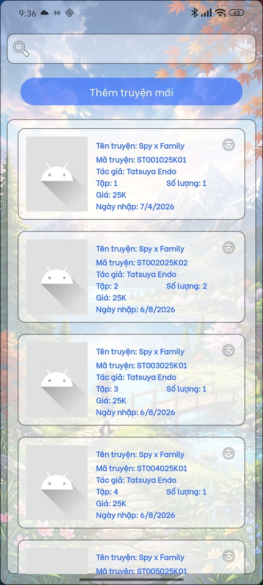
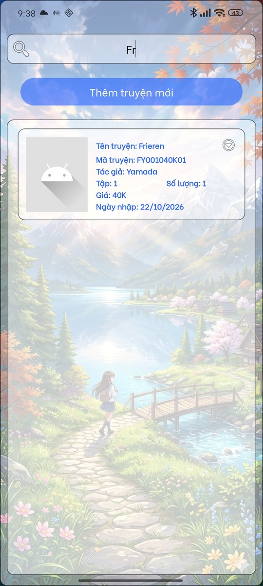
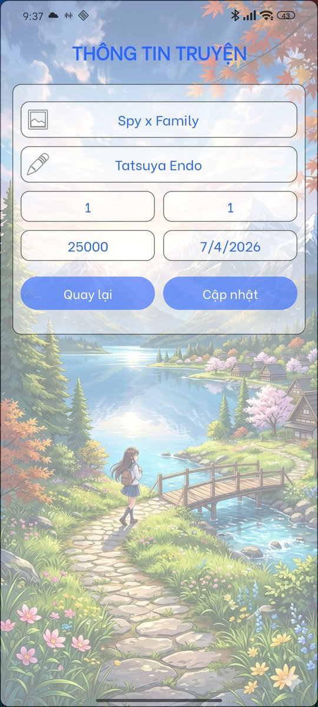
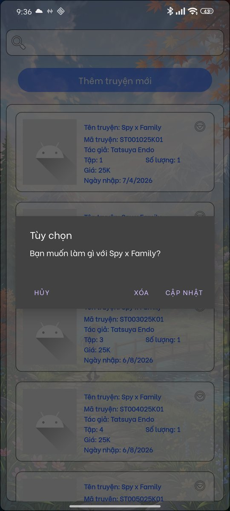

# Manga Manager – Ứng dụng quản lý kho truyện tranh (Android)


Ứng dụng Android giúp quản lý kho truyện tranh: thêm, sửa, xóa và tìm kiếm truyện, theo dõi số lượng và ngày nhập. Dữ liệu lưu trên Firebase Realtime Database, đồng bộ theo thời gian thực và vẫn dùng được khi mất mạng.

## Demo

<p align="center">
  
  
  
  
  
</p>
<p align="center"><em>Danh sách truyện · Tìm kiếm · Thêm truyện · Cập nhật truyện · Tùy chọn</em></p>

## Tính năng

- **Danh sách dạng thẻ** (RecyclerView), sắp xếp theo tên truyện rồi đến số tập
- **Tìm kiếm tức thời** theo tên truyện, không phân biệt hoa thường; kết quả lọc được giữ nguyên khi dữ liệu thay đổi
- **Thêm và cập nhật trên cùng một màn hình**, chọn ngày nhập bằng lịch (DatePicker)
- **Hộp tùy chọn** cho từng truyện: Cập nhật hoặc Xóa
- **Kiểm tra dữ liệu nhập:** không để trống ô nào, nhập sai kiểu số không làm app bị crash
- **Kiểm tra truyện còn tồn tại trước khi cập nhật**, tránh ghi đè lên truyện vừa bị xóa từ thiết bị khác
- **Mã truyện tự sinh** từ chữ cái đầu tên truyện và tác giả, số tập và giá (ví dụ `FY001040K`: Frieren, Yamada, tập 1, 40.000đ)
- **Hoạt động offline:** bật lưu trữ ngoại tuyến của Firebase trong lớp `Application`
- **GitHub Actions** tự động build ứng dụng mỗi lần push

## Công nghệ

- **Ngôn ngữ:** Java
- **Android:** minSdk 24, targetSdk 36, RecyclerView, CardView, Material Components
- **Backend:** Firebase Realtime Database (offline persistence)
- **CI:** GitHub Actions

## Cấu trúc dữ liệu trên Firebase

| Đường dẫn | Trường dữ liệu |
|---|---|
| `Manga/{maHeThong}` | `maHeThong` (mã hệ thống, tạo từ thời gian), `maHienThi`, `tenTruyen`, `tacGia`, `tapSo`, `giaTien`, `soLuong`, `ngayNhap` |

## Cấu trúc mã nguồn

```
app/src/main/java/com/example/managa_manager_v3/
├── StartApp.java          # Lớp Application: bật lưu trữ offline của Firebase một lần khi app khởi động
├── MainActivity.java      # Danh sách truyện, tìm kiếm, sắp xếp
├── MainActivity2.java     # Màn hình thêm / cập nhật truyện
├── truyenAdapter.java     # Adapter của RecyclerView, hộp tùy chọn, xóa truyện
└── Truyen.java            # Lớp dữ liệu
```

## Lịch sử phiên bản

| Phiên bản | Thay đổi chính |
|---|---|
| **v2** | Danh sách dạng ListView; thêm, sửa, xóa truyện; dùng SQLite làm bản lưu cục bộ |
| **v3** | Chuyển sang RecyclerView với adapter riêng; thêm tìm kiếm tức thời; màn hình thêm/sửa riêng; thêm số lượng và ngày nhập; dùng lưu trữ offline của Firebase thay cho SQLite; sửa lỗi crash khi xoay màn hình |
| **v4** *(đang phát triển)* | Đăng nhập bằng Firebase Authentication, giới hạn quyền truy cập database theo tài khoản |

## Cài đặt

1. Clone repo và mở bằng Android Studio
2. Tạo project Firebase, bật **Realtime Database**
3. Tải file `google-services.json` của project đó vào thư mục `app/`
4. Chạy ứng dụng

## Hạn chế và hướng phát triển

- Chưa có đăng nhập và Realtime Database đang mở quyền đọc, ghi; sẽ thêm Firebase Authentication và Security Rules theo tài khoản ở v4.
- Tìm kiếm thực hiện trên danh sách đã tải về máy, vì Realtime Database không hỗ trợ truy vấn "có chứa"; phù hợp với kho truyện quy mô nhỏ.
- Ngày nhập đang lưu dạng chuỗi `ngày/tháng/năm`, nên chưa sắp xếp hoặc lọc theo ngày được.
- Mã hệ thống tạo từ thời gian (mili giây), có thể trùng nếu hai thiết bị thêm truyện cùng lúc; có thể chuyển sang khóa tự sinh `push()` của Firebase.
- Xóa truyện chưa có bước xác nhận lần hai.
- Ảnh truyện đang dùng ảnh mặc định.

## Tác giả

Nguyễn Khắc Hùng Cường – Sinh viên Kỹ thuật máy tính
